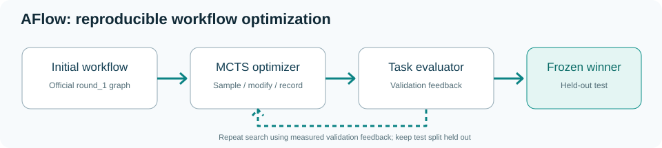
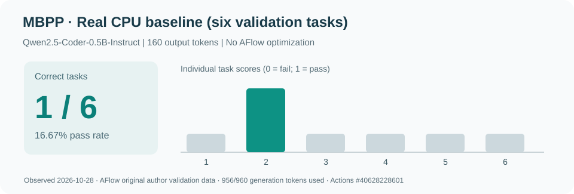
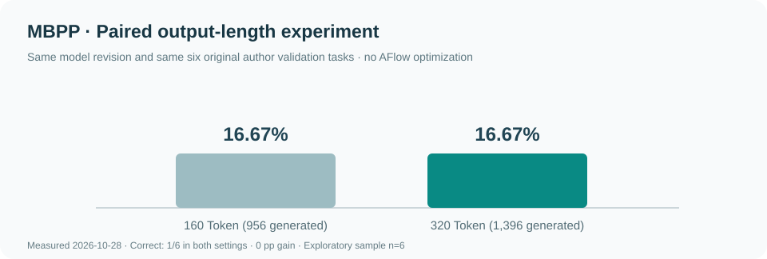
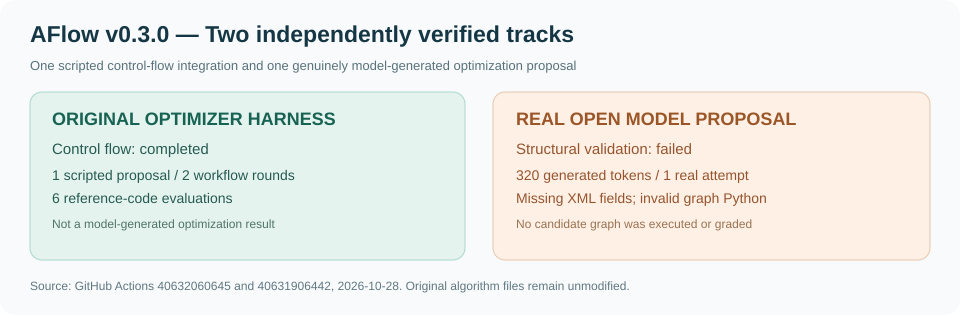

# AFlow-Repro

**AFlow (ICLR 2025 Oral): faithful source reproduction and independent evaluation.**  
**AFlow（ICLR 2025 Oral）：原始源码复现与独立实验验证。**

[ICLR 2025 paper / 正式论文](https://proceedings.iclr.cc/paper_files/paper/2025/hash/5492ecbce4439401798dcd2c90be94cd-Abstract-Conference.html) · [OpenReview](https://openreview.net/forum?id=z5uVAKwmjf) · [Official source / 官方源码](https://github.com/FoundationAgents/AFlow) · [Original README / 官方说明](docs/UPSTREAM_README.md)

> **Status / 当前状态：Author MBPP dataset verified; 20 reference programs tested successfully; real six-example CPU-model baseline measured. Full AFlow MCTS experiments and paper metrics NOT yet reproduced.**
>
> **进度：已取得原作者 MBPP 数据，完成 20 道参考代码评测和 6 道真实开源模型基线；尚未进行完整 MCTS 搜索，不能宣称论文指标复现完成。**

## Research goal / 研究目标

AFlow optimizes code-represented Agent workflows through search, task execution, and experience feedback. **First reproduce the original code and experiments; only then study modifications.**

AFlow 通过搜索、任务执行与经验反馈来优化代码表示的 Agent 工作流。本仓库首先保持官方核心算法不变，复现其工作流优化与基准评测，再开展改进研究。

## Provenance / 源码溯源

| Item / 项目 | Description / 说明 |
|---|---|
| Upstream / 官方仓库 | [FoundationAgents/AFlow](https://github.com/FoundationAgents/AFlow) |
| Frozen commit / 固定版本 | [3f457218fc716093fe53f6df8a5d5e6379d66346](https://github.com/FoundationAgents/AFlow/commit/3f457218fc716093fe53f6df8a5d5e6379d66346) |
| Exact source verification / 哈希校验 | 102 of 102 upstream text files match |
| Source license / 许可证 | MIT, see [LICENSE](LICENSE) |
| Relocated upstream README / 原始 README | [docs/UPSTREAM_README.md](docs/UPSTREAM_README.md) |
| Not vendored / 未复制 | Three official JPG figures; externally hosted dataset and results archives |
| Core algorithm changes / 核心算法修改 | None / 无 |
| Reproduction additions / 新增 | CI, tests, tools, docs and local config example |

Details / 完整协议：[REPRODUCTION.md](docs/REPRODUCTION.md).

## Architecture / 核心模块

- **Node / Operator**: calls the model, generates code, tests or combines answers.
- **Workflow**: executable Python graph of operators.
- **Optimizer**: samples historical workflows, proposes modifications and learns from scores.
- **Evaluator**: runs real tasks and records accuracy and costs.

The original source remains in the official module layout: scripts/, benchmarks/, data/, workspace/.  
官方算法文件保持原样，以便对照验证。

## Environment / 环境

The upstream README specifies Python 3.9. Use a fresh virtual environment.

~~~bash
python3.9 -m venv .venv
source .venv/bin/activate                  # Windows: .venv\Scripts\activate
python -m pip install -r requirements-repro.txt
python -m unittest discover -s tests -v
python tools/preflight.py --dataset MBPP
~~~

The additional requirements file preserves the original pinned requirements and adds the missing direct downloader dependency (requests).

模型配置：将 config/local.example.yaml 复制到 config/config2.yaml，并修改为本地 OpenAI-compatible 模型推理端点（如 vLLM）。模型必须接受正确的名称。**本项目不依赖 Claude Code、Codex 等外部 Agent 宿主；但实际推理仍需要模型服务。**

~~~bash
cp config/local.example.yaml config/config2.yaml
~~~

A locally hosted model is an **adaptation**. It does not by itself reproduce the exact published metrics, which depend on model choice and inference settings.

## Dataset / 数据集

The authors publish archives outside GitHub, and raw data is intentionally not included here. Download the benchmark data only:

~~~bash
python -c "from data.download_data import download; download(['datasets'])"
python tools/preflight.py --dataset MBPP --strict
~~~

Inspect the archive and dataset filenames before execution. Data and generated-code execution must run in a disposable, restricted environment.

## Baseline / 基线

The frozen upstream run_baseline.py references workflow rounds absent from the official source tree. A separate, clearly labeled direct-model baseline runner was added; it uses the original CustomCodeGenerate operator and MBPPBenchmark evaluator.

~~~bash
# Two examples only: smoke test, NOT paper result
python tools/run_mbpp_baseline.py --model local-executor --split validate --limit 2
# Full validation baseline
python tools/run_mbpp_baseline.py --model local-executor --split validate
~~~

## AFlow optimization / 原方法工作流搜索

The official search entrypoint is left untouched:

~~~bash
python run.py --dataset MBPP --sample 4 --initial_round 1 --max_rounds 20 \
  --validation_rounds 5 --opt_model_name local-optimizer --exec_model_name local-executor
~~~

After freezing workflow selection, evaluate exactly once on the untouched test split. For the direct baseline:

~~~bash
python tools/run_mbpp_baseline.py --model local-executor --split test --allow-test
~~~

Do not use the test split to select prompts, workflow versions or hyperparameters. The original evaluator executes generated Python. Its thread timeout is **not a security sandbox**.

## Actual results only / 真实实验数据可视化

When a real optimization run has produced an actual results file, create its curve:

~~~bash
python tools/plot_results.py --input workspace/MBPP/workflows/results.json \
  --output experiments/mbpp/validation_curve.svg --title "MBPP measured validation accuracy"
~~~

No fabricated plots or paper-sourced results are presented as measurements. Real experiments must record checkpoint and dataset checksums, model/decoding parameters, search budget, seeds, raw trajectories and error cases.

### Measured MBPP CPU baseline / 实测开源模型基线

On the **original AFlow author MBPP validation split** (86 problems), a real locally loaded Qwen2.5-Coder-0.5B-Instruct model solved **1/6 of the first six tasks (16.67%)** with 160 output tokens, greedy decoding and the unchanged AFlow code-generator operator. **This is NOT an AFlow-optimized result, and it is not statistically representative.** The generation budget was almost completely exhausted (956 of 960 available tokens). [Experiment record](docs/EXPERIMENT_001.md) · [Original raw output artifact](https://github.com/ZJY-HSBL/AFlow-Repro/actions/runs/40628228601).

在原作者的 MBPP 验证集上，开源模型首次实测 6 道题正确 1 道，准确率 16.67%；输出预算消耗 956/960 Token。**这不是 MCTS 优化结果，也不能用 6 道题直接推断完整基准表现。**

### Paired decoding ablation / 配对输出长度消融

Keeping the **same 6 validation prompts**, identical model checkpoint, evaluator and greedy decoding, increasing the output cap from 160 to 320 tokens produced **1/6 correct in both runs (0 percentage-point gain)**. Two model predictions changed, but neither became correct. Tokens generated rose from 956 to 1,396. **This is a tiny, descriptive comparison, not a statistical claim about the full dataset.** [Full experiment notes](docs/EXPERIMENT_002.md) · [320-token run evidence](https://github.com/ZJY-HSBL/AFlow-Repro/actions/runs/40628958327).

在模型、验证题目及评分规则不变的条件下，160 与 320 Token 的正确率均为 16.67%。仅增大输出长度未改善这 6 题的成功数；下一步需要研究 Agent 的测试反馈与自动修复机制。

### Original dataset and evaluator / 作者数据与评测验证

- The original 15-file author archive was downloaded and verified, SHA256 recorded in [provenance metadata](experiments/original-data/manifest.json).
- 20 reference implementations scored 20/20 through the original AFlow MBPP grading semantics under isolated Docker (this is an **oracle sanity check**, never an LLM score). [Evidence](experiments/original-data/mbpp_oracle_20.json).
- The author's 1,538-file historical search archive was also verified once ([SHA256 manifest](experiments/original-data/author_trajectories_provenance.json)); these archived trajectories are not newly run optimization experiments.
- Automated tests additionally enforce exact original Git blob checksums for all 102 upstream text files.

### v0.3.0 — Original optimizer closed-loop and real proposal feasibility / 原始优化器闭环与真实提案检查

**A. Reproducible original-control-flow integration.** In a disposable CI checkout, the unmodified `Optimizer._optimize_graph()` completed baseline evaluation, candidate selection, graph/prompt writing, import, evaluation, and experience recording on 3 author MBPP validation examples. One *scripted* optimizer proposal and six *reference-solution* code executions were involved. Both workflow scores were 3/3 because the harness used author reference solutions, **not any LLM inference**. No improvement was observed (`succeed=false`). [Original optimizer CI evidence](https://github.com/ZJY-HSBL/AFlow-Repro/actions/runs/40632060645).

**B. Actual model optimizer-proposal feasibility.** Qwen2.5-Coder-0.5B-Instruct received the original 6,709-character AFlow graph-optimization prompt (1,392 input tokens), generated 320 tokens, and produced an incomplete, syntactically invalid proposal: `modification` and `prompt` were empty, and `graph.py` failed AST compilation. Upstream XML parsing nevertheless returned `valid=True`, revealing a missing structural validation boundary. **No autonomous model-generated workflow was executed.** [Actual open-model inference evidence](https://github.com/ZJY-HSBL/AFlow-Repro/actions/runs/40631906442).

**C. Added strict pre-import gate.** `tools/validate_workflow_proposal.py` checks all required fields, graph structure and Python syntax (including `prompt.py`) before any dynamic import. It is a preflight guard, **not** a secure execution sandbox. Original AFlow algorithm files remain SHA-identical to upstream.

从本次两项实验可以严格区分：原始 AFlow 搜索控制逻辑能够运行，但目前的 0.5B 模型在一次正式优化提示词测试中未生成可执行工作流。这不能归结为搜索算法失效，更不能声称已经获得 AFlow 搜索收益。[实验分析](docs/EXPERIMENT_003.md)。

## Progress / 复现进度

- [x] Confirm ICLR 2025 and pin the exact upstream commit.
- [x] Import and verify 102 upstream text files against original Git blob hashes.
- [x] Add offline tests, experiment preflight, MBPP baseline runner and measured-curve plotter.
- [x] CI green: Python 3.9 syntax, original-source SHA checks and offline tests, CLI import smoke tests.
- [x] Download original author MBPP data; verify 20 reference tests; run a real six-task CPU-model baseline (smoke evaluation).
- [x] Execute original AFlow optimizer end-to-end with a deterministic transport and sandboxed reference evaluator (integration test only).
- [x] Probe a real open-weight LLM on the unmodified optimizer prompt; record invalid candidate and add a strict schema/syntax gate.
- [ ] Complete a genuinely model-generated, executable AFlow search iteration and held-out evaluation.
- [ ] Perform untouched test evaluation and multi-seed statistical analysis.
- [x] Publish a source-backed real-model six-task SVG and raw evidence links.
- [ ] Expand baseline to full validation with matched models, then publish repeated-run statistical reports.

## Acknowledgement / 致谢

Independent reproduction, not an official AFlow release. Original method and MIT-licensed code belong to Jiayi Zhang et al. and FoundationAgents. Cite the [ICLR 2025 paper](https://openreview.net/forum?id=z5uVAKwmjf) and credit the [official project](https://github.com/FoundationAgents/AFlow).
